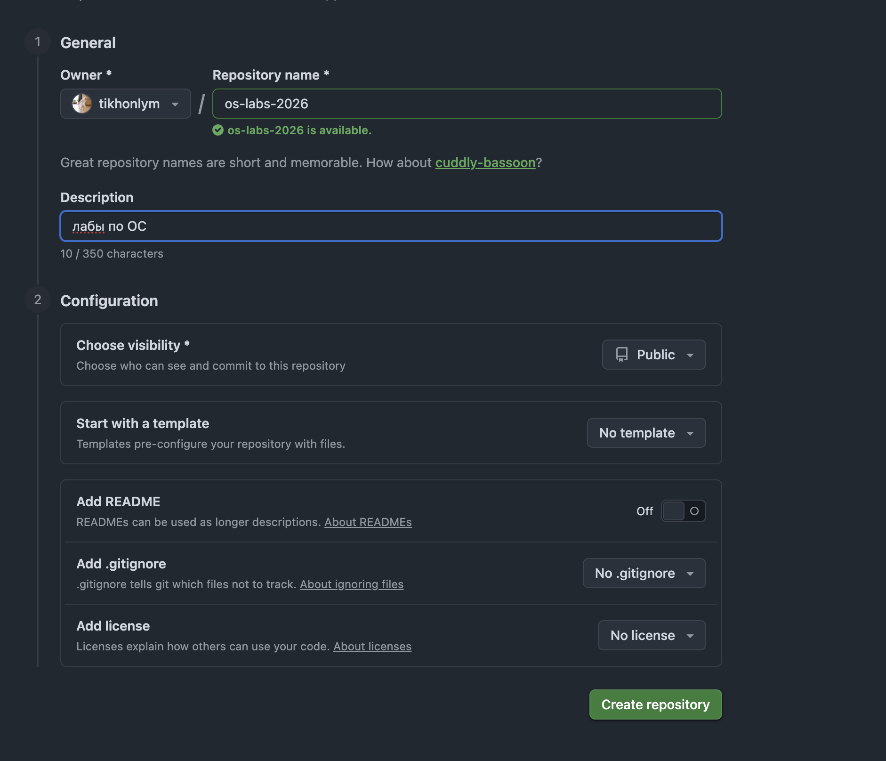
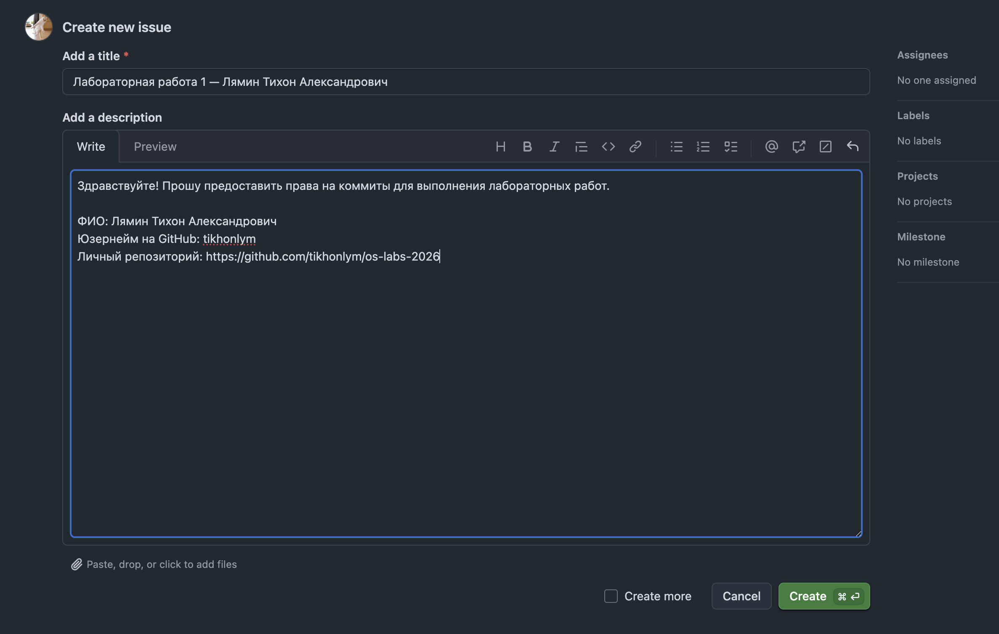
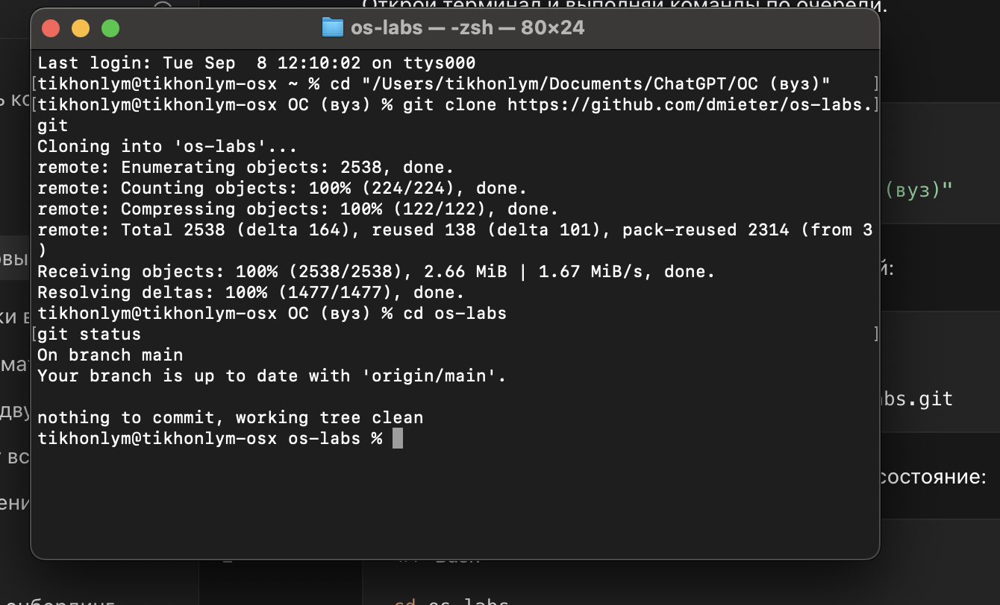
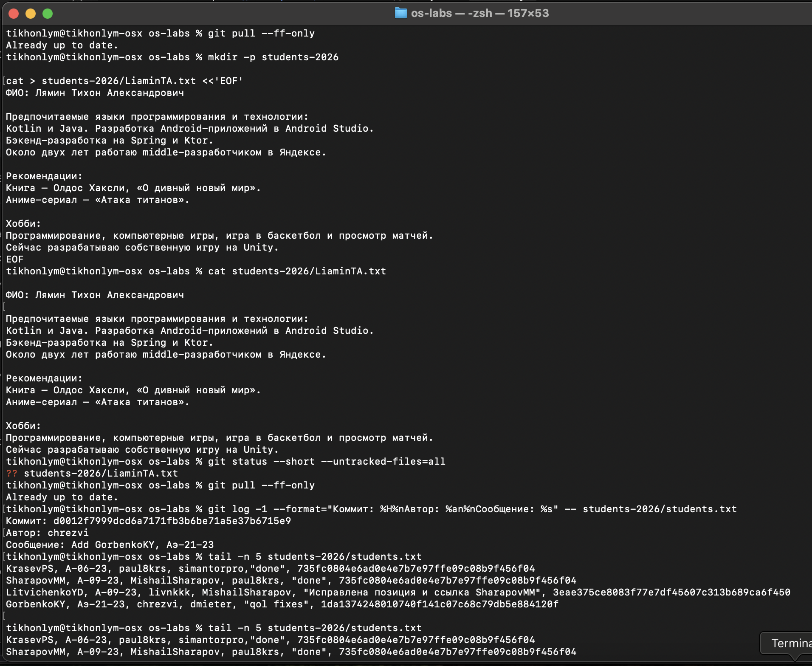
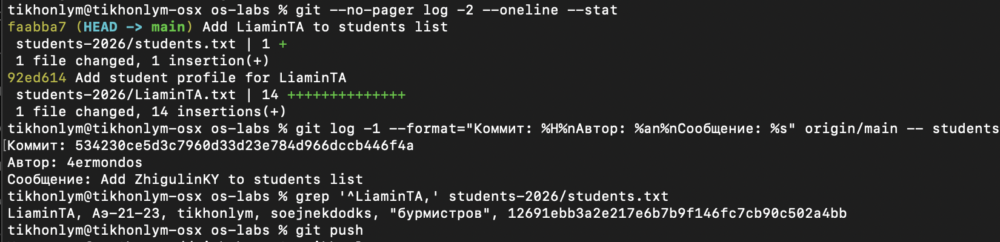
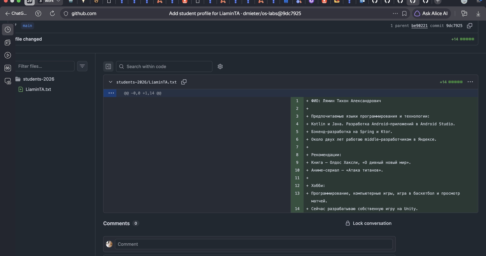
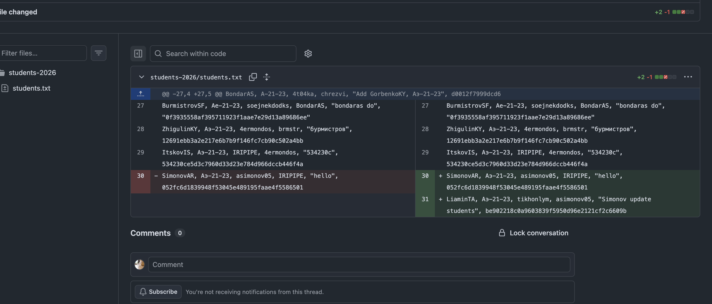

# Лабораторные работы по операционным системам

- **Студент:** Лямин Тихон Александрович
- **Группа:** Аэ-21-23
- **Имя ОСЭП МЭИ:** LiaminTA
- **GitHub:** [tikhonlym](https://github.com/tikhonlym)

## Лабораторная работа № 1

[Задание](https://github.com/dmieter/os-labs/blob/main/labs-2026/lab-1/README.md)

### Результат

- [Задача о предоставлении доступа № 273](https://github.com/dmieter/os-labs/issues/273) — закрыта преподавателем.
- [Коммит с файлом `students-2026/LiaminTA.txt`](https://github.com/dmieter/os-labs/commit/9dc792555c3eb0f6d42a0e036ec5e0af72224bb1).
- [Коммит с добавлением строки в `students-2026/students.txt`](https://github.com/dmieter/os-labs/commit/aec20eb0b2bb4f6fb59c6bcf92c7334f9ad87a4c).

Перед отправкой изменений был проверен последний коммит общего списка студентов:
[`be902218c0a9603839f5950d96e2121cf2c6609b`](https://github.com/dmieter/os-labs/commit/be902218c0a9603839f5950d96e2121cf2c6609b),
автор `asimonov05`, сообщение `Simonov update students`.

### Скриншоты выполнения

#### 1. Создание личного репозитория

#### 2. Подготовка задачи о предоставлении доступа

#### 3. Клонирование репозитория преподавателя

Команды `git clone` и `git status` выполнены в терминале.

#### 4. Создание файла с информацией о студенте

#### 5. Промежуточная проверка локальных коммитов

На этом снимке показаны локальные коммиты до обновления ветки по новым изменениям других студентов.
Ссылки на окончательные опубликованные коммиты приведены в разделе «Результат».

#### 6. Опубликованный коммит с файлом студента

#### 7. Опубликованное изменение общего списка

В список добавлена строка LiaminTA. Также добавлен перевод строки после предыдущей записи,
поскольку исходный файл не заканчивался переводом строки; текст предыдущей записи сохранён.

## Лабораторная работа № 2

[Отчёт, результаты и скриншоты](lab-2/README.md)
