# Лабораторная работа № 2

- Студент: Лямин Тихон Александрович
- Группа: Аэ-21-23
- Логин ОСЭП МЭИ: LiaminTA
- [Задание преподавателя](https://github.com/dmieter/os-labs/tree/main/labs-2026/lab-2)

## Индивидуальное задание

В файле `labdata-21.log` найден указатель `LiaminTA` на строке 1652. Текст задания расположен в строках **935–942** и сохранён в [task-LiaminTA.txt](task-LiaminTA.txt).

## Результат

Создан [каталог Los_Angeles_Lakers](Los_Angeles_Lakers/) с пятью игроками. В каталоге каждого игрока находится `info.txt` с именем, позицией, возрастом, ростом и характеристикой. Данные сверены с [составом команды на NBA.com](https://www.nba.com/team/1610612747/lakers) по состоянию на 8 октября 2026 года.

В [файл Луки Дончича](Los_Angeles_Lakers/Luka_Doncic/info.txt) командой `pwd` добавлен полный путь к текущему каталогу. Сообщение об ошибке `mkdir` сохранено в [mkdir_error.txt](Los_Angeles_Lakers/mkdir_error.txt).

После обновления репозитория преподавателя выведены первые строки анкет студентов, имена файлов которых начинаются с согласной. Результат из 33 строк сохранён в [students_consonants.txt](students_consonants.txt). Первые строки сохранены в исходном виде, включая пометки, которые добавили сами студенты.

## Скриншоты

### Обновление репозитория и поиск файла группы

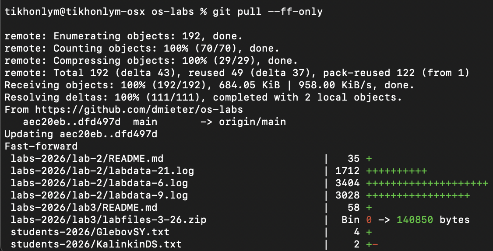
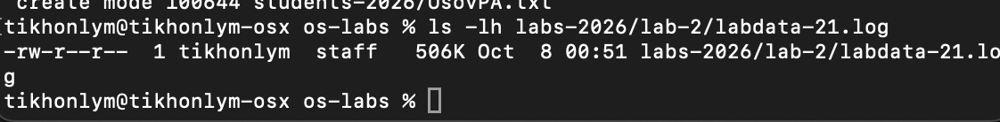

### Просмотр файла и поиск задания в less

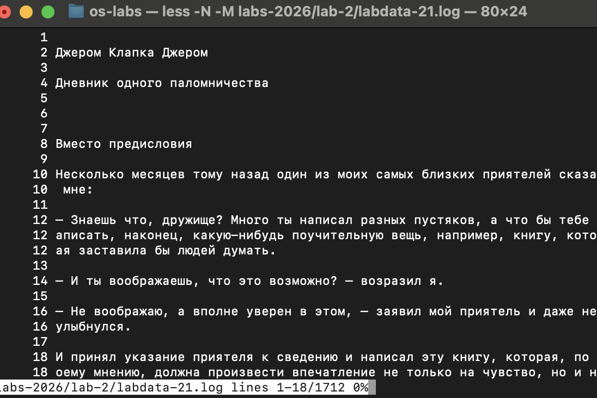
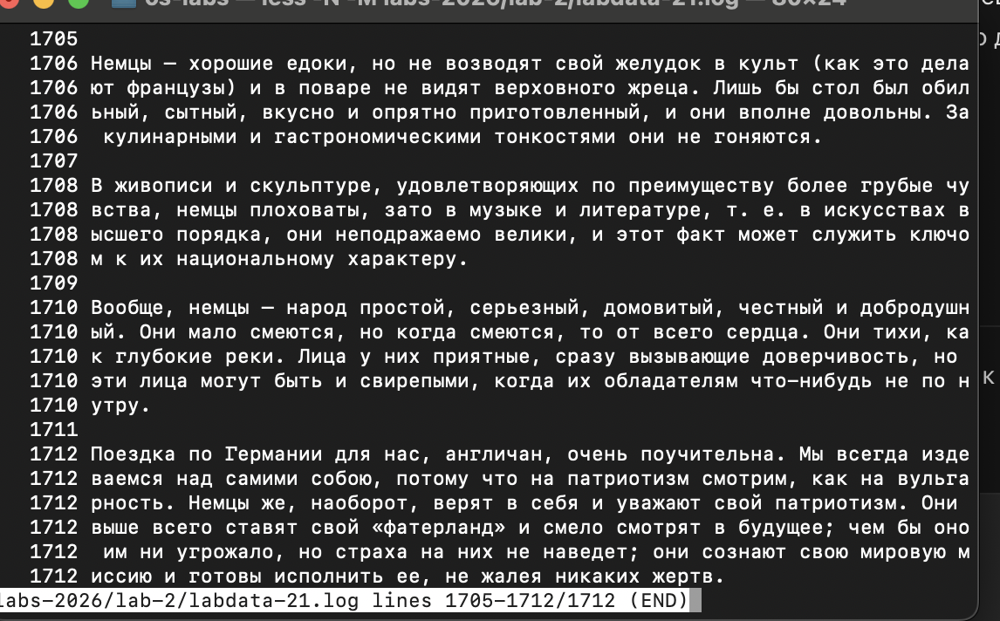
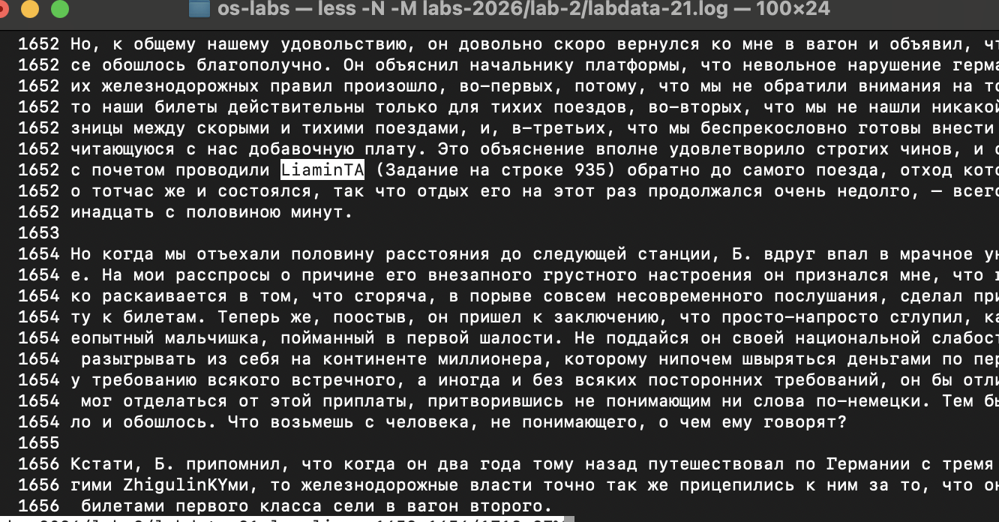
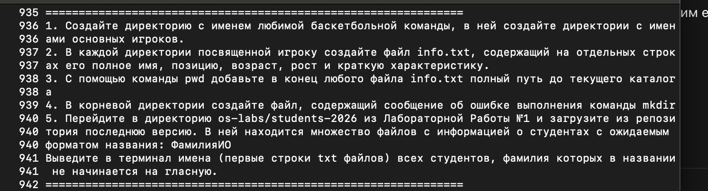

### Выполнение индивидуального задания

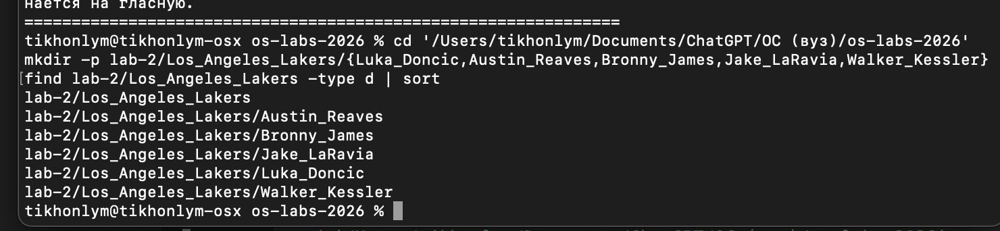
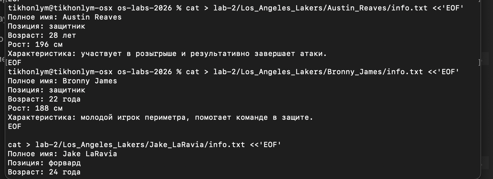
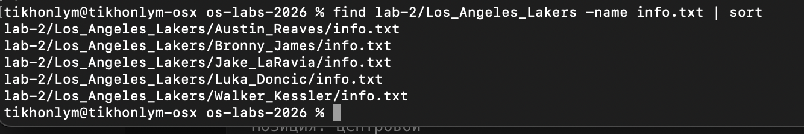
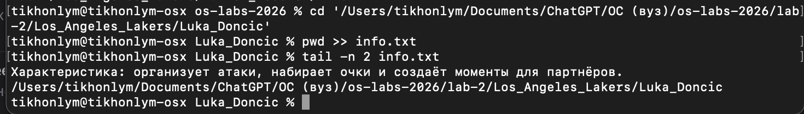
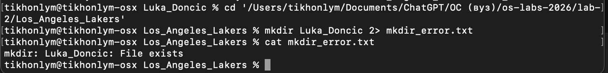
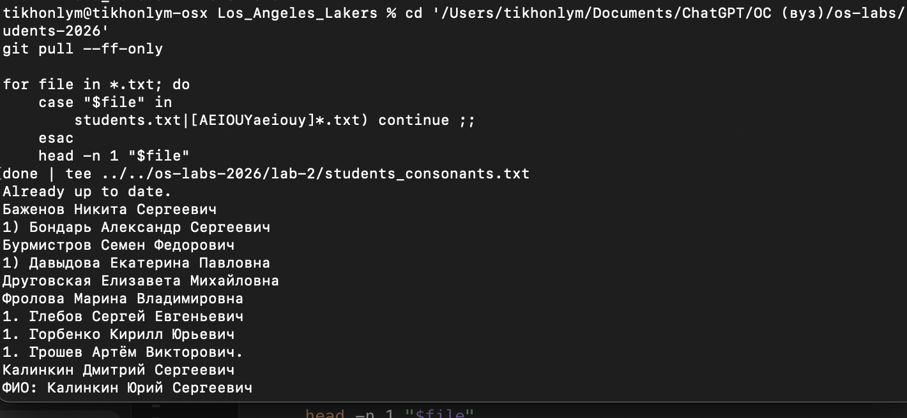
