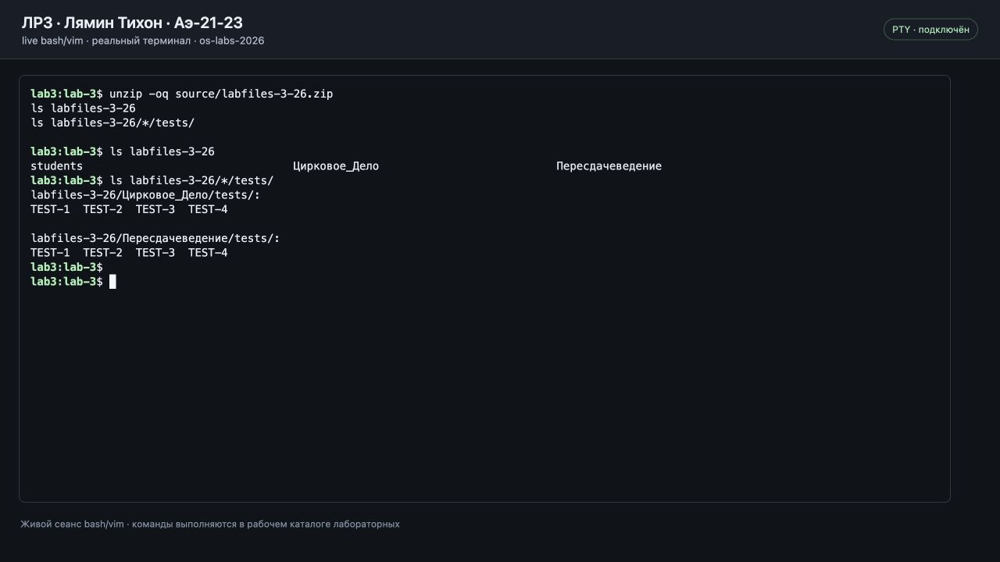
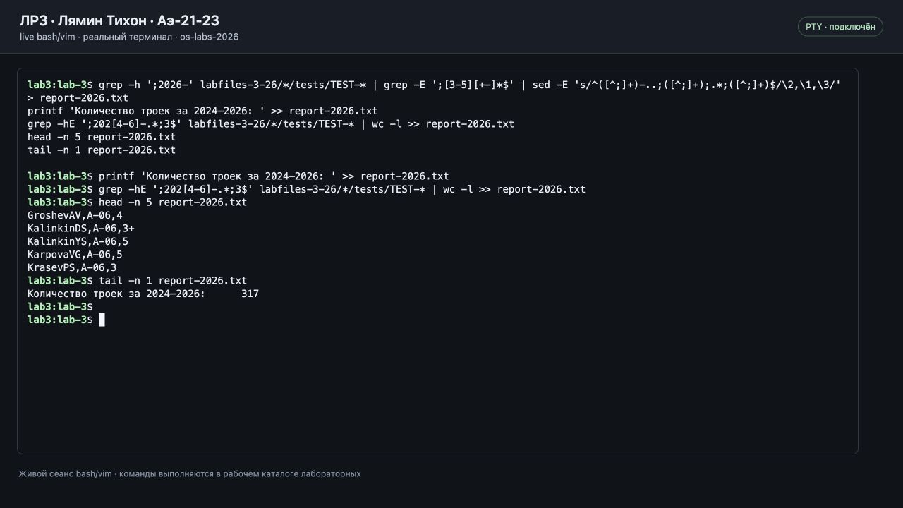
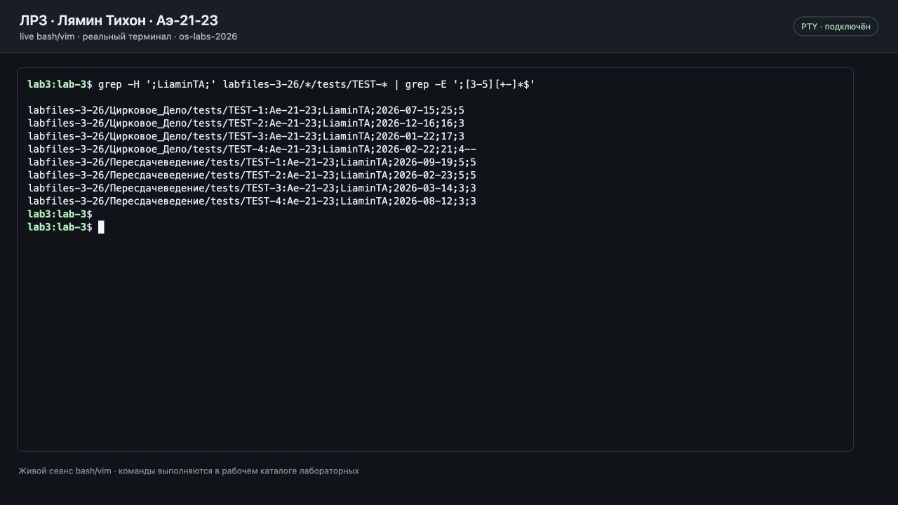
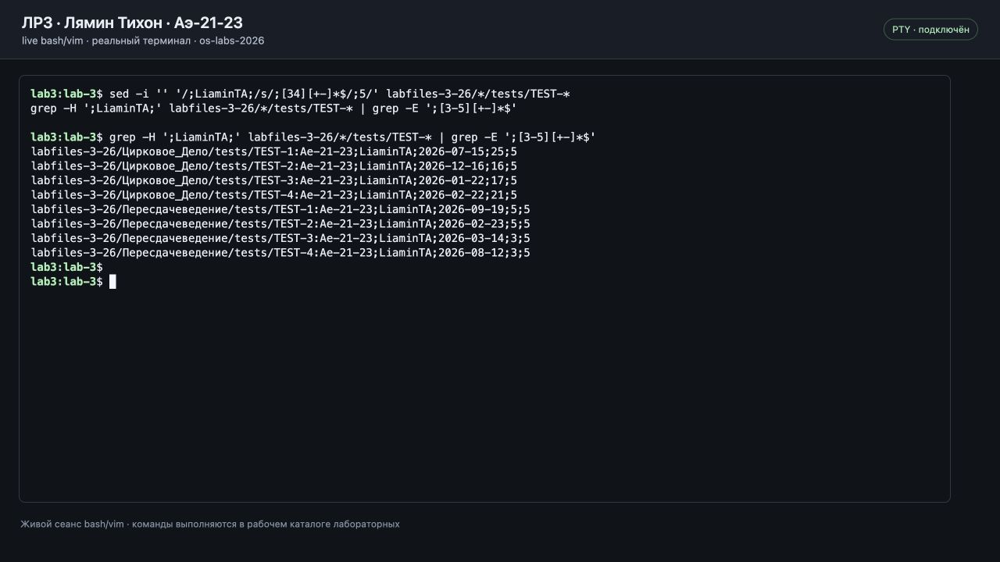
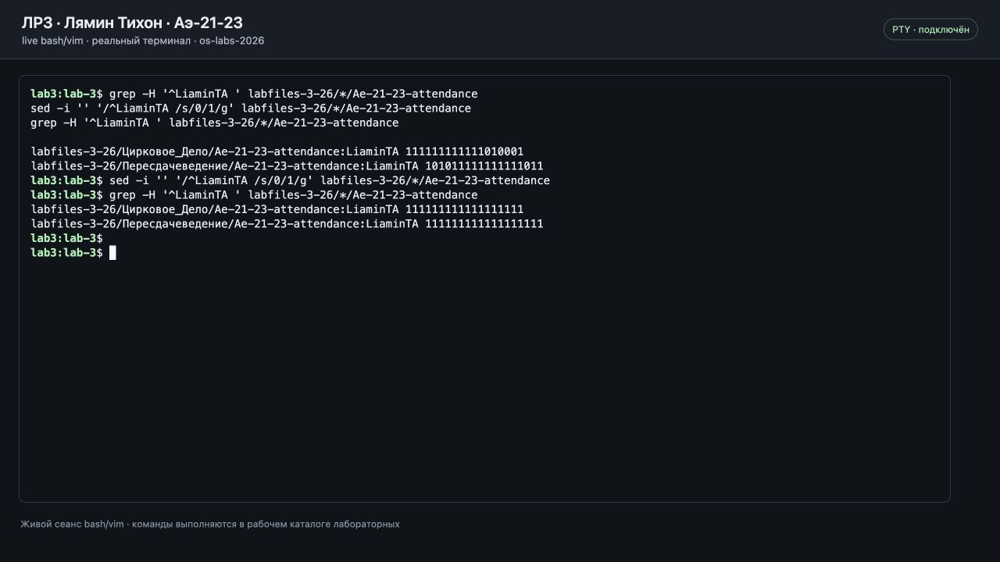
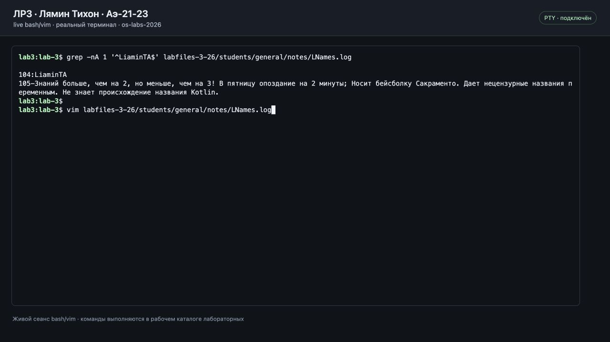
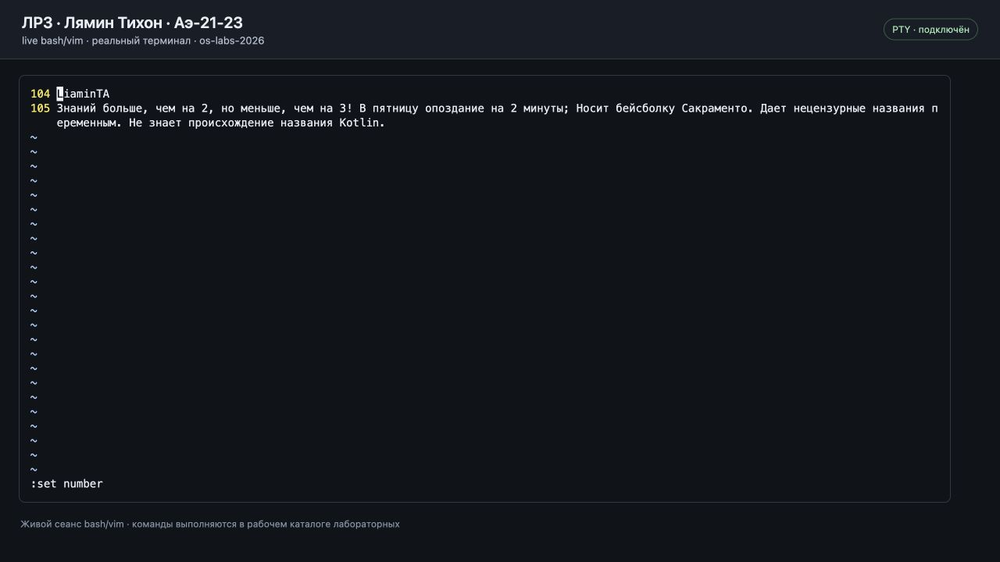
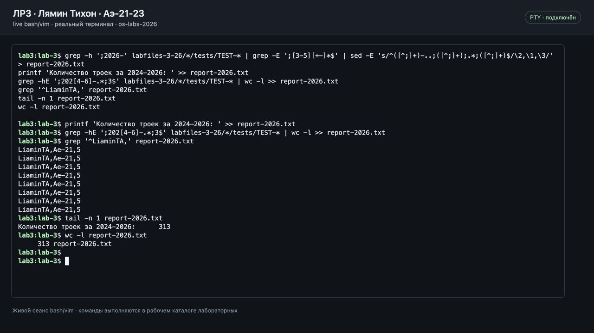

# Лабораторная работа № 3

Лямин Тихон Александрович, Аэ-21-23, LiaminTA. Вариант — нечётный.

## 1. Распаковка архива

## 2. Создание отчёта за 2026 год и подсчёт троек за 2024–2026 годы

## 3. Поиск и исправление собственных оценок

## 4. Исправление посещаемости

## 5. Исправление досье в Vim

## 6. Итоговый отчёт

[report-2026.txt](report-2026.txt): 312 успешных попыток за 2026 год; количество троек за 2024–2026 годы — 313.

