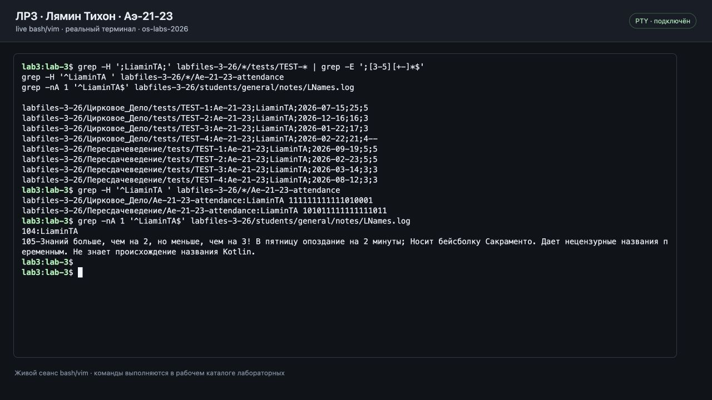
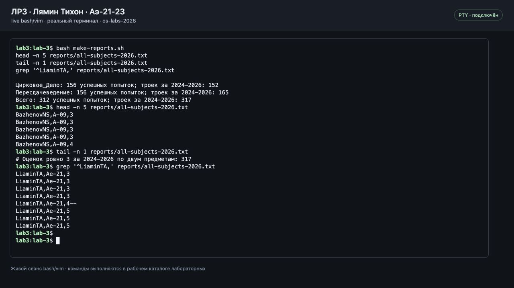
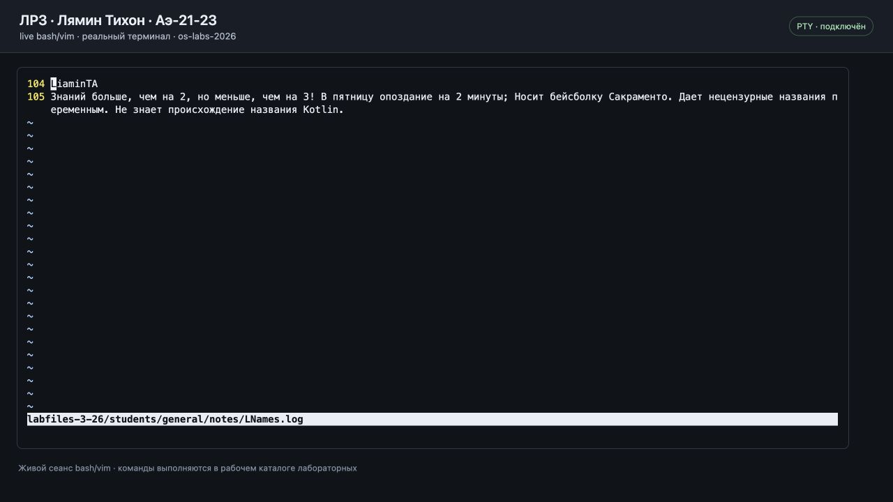
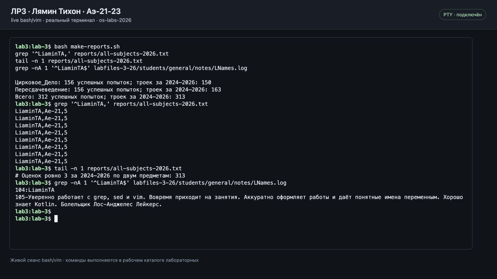
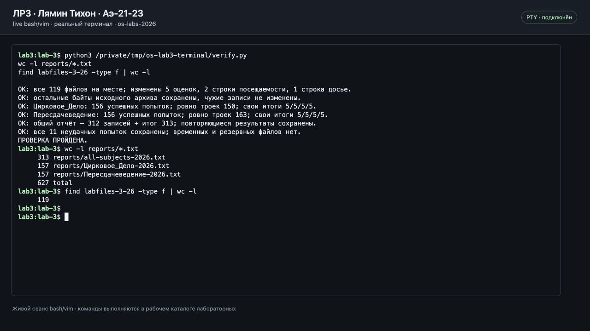

# Лабораторная работа № 3

- Студент: Лямин Тихон Александрович.
- Группа: Аэ-21-23; логин ОСЭП МЭИ: `LiaminTA`.
- Вариант: **нечётный**, в фамилии «Лямин» 5 букв.
- [Задание преподавателя](https://github.com/dmieter/os-labs/tree/main/labs-2026/lab3).

## Исходные данные

Работа выполнена на учебных данных из архива преподавателя. Образ преподавателя: строгий, внимательно проверяет все попытки, посещаемость и личные заметки.

Исходный архив сохранён в [source/labfiles-3-26.zip](source/labfiles-3-26.zip), итоговые файлы — в [labfiles-3-26](labfiles-3-26/). В архиве 119 файлов, два предмета: «Цирковое_Дело» и «Пересдачеведение», по четыре теста в каждом.

Источник: [коммит `29d6194`](https://github.com/dmieter/os-labs/commit/29d61944ef45011273d289217308082ad25bc31b). Задание и архив сверены с актуальной веткой преподавателя 26 октября 2026 года.

SHA-256 исходного архива:

```text
5a81732c529359c7cabaa5167bdf92046f68242c5a5f3a539f9bd2f57951265c
```

Все команды ниже выполняются из каталога `lab-3`. Использованы `unzip`, `grep`, `sed`, `sort`, `wc`, `tr` и `vim`; `awk` не использовался.

## 1. Распаковка и поиск записей

```bash
unzip -q source/labfiles-3-26.zip
ls labfiles-3-26
grep -nH ';LiaminTA;' labfiles-3-26/*/tests/TEST-*
grep -nH '^LiaminTA ' labfiles-3-26/*/Ae-21-23-attendance
grep -nA 1 '^LiaminTA$' labfiles-3-26/students/general/notes/LNames.log
```




## 2. Отчёты за 2026 год

В отчётах сохранена каждая успешная попытка за 2026 год, включая оценки со знаками `+` и `-`. Формат строки: `фамилия,группа без года,оценка`.

Пример команды для одного предмета:

```bash
grep -hE '^[^;]+;[^;]+;2026-[0-9]{2}-[0-9]{2};[0-9]+;[3-5][+-]*$' \
  labfiles-3-26/Цирковое_Дело/tests/TEST-* |
sed -E 's/^([^;]+)-[0-9]{2};([^;]+);[^;]+;[^;]+;([^;]+)$/\2,\1,\3/' |
sort
```

`grep -h` убирает имена исходных файлов из вывода. `sed` оставляет имя, группу без года набора и оценку. `sort` упорядочивает строки, но не удаляет одинаковые результаты разных тестов.

Подсчёт троек за 2024–2026 годы:

```bash
grep -hE '^[^;]+;[^;]+;202[4-6]-[0-9]{2}-[0-9]{2};[0-9]+;3$' \
  labfiles-3-26/Цирковое_Дело/tests/TEST-* | wc -l
```

Условие `оценка == 3` трактуется как точное значение поля `3`, без пометок. Эта трактовка совпадает с проверенными примерами студентов группы. Итоговые количества: 150 и 163, всего **313**. Если дополнительно считать `3+`/`3++`, получится 155 и 163, всего 318; этот расширенный подсчёт не используется в итоговой строке отчёта.

Все три отчёта создаёт [make-reports.sh](make-reports.sh):

```bash
bash make-reports.sh
```

Сначала отчёты созданы по исходным данным; после пункта 3 они сформированы повторно.



## 3. Индивидуальное задание

### Оценки — sed

```bash
sed -i '' -E '/^Ae-21-23;LiaminTA;/s/;[34][+-]*$/;5/' \
  labfiles-3-26/*/tests/TEST-*
grep -H ';LiaminTA;' labfiles-3-26/*/tests/TEST-* | grep -E ';[3-5][+-]*$'
```

`-i ''` — запись на месте без резервной копии в `sed` macOS. Для GNU/Linux используется `-i` без пустого аргумента.

В исходных данных у студента ровно одна успешная попытка каждого теста. Изменены только пять оценок в этих попытках: `3`, `3`, `4--` по «Цирковому_Делу» и `3`, `3` по «Пересдачеведению» заменены на `5`. Ещё три итоговые оценки уже были пятёрками. Все 11 неудачных попыток сохранены; даты, количество правильных ответов и записи других студентов не изменялись.


### Посещаемость — sed

```bash
grep -H '^LiaminTA ' labfiles-3-26/*/Ae-21-23-attendance
sed -i '' '/^LiaminTA /s/0/1/g' labfiles-3-26/*/Ae-21-23-attendance
grep -H '^LiaminTA ' labfiles-3-26/*/Ae-21-23-attendance
```

Заменены только нули в строках `LiaminTA`: посещаемость стала 18/18 вместо 14/18 и 15/18.


### Досье — vim

```bash
vim -Nu NONE -n -i NONE labfiles-3-26/students/general/notes/LNames.log
```

В редакторе включены номера строк командой `:set number` и строка состояния командой `:set laststatus=2`; команда `zt` помещает найденную запись в начало экрана. Выполнены поиск `/^LiaminTA$`, переход `j` на следующую строку и `cc` для замены характеристики. Новый текст:

> Уверенно работает с grep, sed и vim. Вовремя приходит на занятия. Аккуратно оформляет работы и даёт понятные имена переменным. Хорошо знает Kotlin. Болельщик Лос-Анджелес Лейкерс.

После ввода: `Esc`, `:wq`, `Enter`. Изменена только строка досье `LiaminTA`.




## 4. Итоговые результаты

После изменения исходных файлов повторно выполнена команда `bash make-reports.sh`.

| Результат | Цирковое_Дело | Пересдачеведение | Всего |
|---|---:|---:|---:|
| Успешные попытки за 2026 год | 156 | 156 | 312 |
| Оценки ровно 3 за 2024–2026 до исправлений | 152 | 165 | 317 |
| Оценки ровно 3 за 2024–2026 после исправлений | 150 | 163 | 313 |
| Итоговые пятёрки LiaminTA | 4 | 4 | 8 |

Готовые отчёты:

- [Общий отчёт по двум предметам](reports/all-subjects-2026.txt): 312 строк результатов и строка общего количества троек.
- [Цирковое_Дело](reports/Цирковое_Дело-2026.txt): 156 строк результатов и итоговый счётчик.
- [Пересдачеведение](reports/Пересдачеведение-2026.txt): 156 строк результатов и итоговый счётчик.



Проверено сравнением с исходным ZIP: изменены только пять оценок, две строки посещаемости и одна строка досье. Все остальные данные сохранены. Итоговые отчёты независимо сверены с исходными строками тестов с учётом повторяющихся результатов; временных и резервных файлов в сдаче нет.



Скриншоты сделаны с работающего терминала Bash/Vim в локальном браузере во время выполнения команд.

## Для защиты

- `^` и `$` обозначают начало и конец строки; `[^;]+` — поле без точки с запятой.
- `[3-5][+-]*` выбирает успешную оценку с возможными пометками; `202[4-6]` — нужные три года.
- `grep -h`, `-n`, `-H`, `-A 1` соответственно скрывают имя файла, показывают номер строки, добавляют имя файла и выводят следующую строку.
- В `sed` адрес `/^Ae-21-23;LiaminTA;/` ограничивает замену собственной записью. Скобки создают группы, `\1`, `\2`, `\3` подставляют найденные поля.
- В Vim: `/текст` — поиск, `n` — следующее совпадение, `j` — строка вниз, `cc` — заменить строку, `Esc` — выйти из ввода, `:wq` — сохранить и выйти, `:q!` — выйти без сохранения.

## Сверка с примерами студентов

Для проверки состава сдачи и трактовки счётчика просмотрены [ЛР3 Фроловой](https://github.com/pflpl/os-labs-frolova/tree/main/lab3), [ЛР3 Жигулина](https://github.com/4ermondos/OS_labs_repository/tree/main/Lab3) и [ЛР3 Горбенко](https://github.com/chrezvi/os-lab3). В их общих отчётах также по 312 строк результатов. Исходный счётчик 317 в двух нечётных вариантах соответствует точному значению `3`. Это примеры опубликованных работ, а не подтверждение приёмки преподавателем; расчёты и команды в этой работе выполнены самостоятельно.
